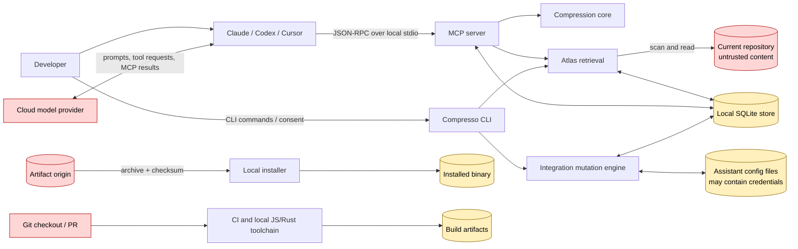

# Compresso Threat Model — E1-E7 Offline Vertical Slice

Assessment date: 2026-07-22

Status: validated against owner deployment assumptions

Method: repository-driven defensive threat modeling of implemented behavior

Remediation update: **2026-07-23. TM-003 is mitigated in the current working tree, pending commit/release.** Public plans now serialize only a key-level, secret-safe projection; exact configuration bytes are confined to private hashing and authenticated recovery persistence. Credentials exposed before this change still require separate revocation or rotation.

## Executive summary

Compresso is a local-first context intelligence layer that indexes repositories, compresses text, stores metadata in SQLite, and exposes read-only MCP tools to AI coding clients. Its implemented runtime has no direct cloud or telemetry channel. The decisive trust boundary is nevertheless not “the device”: repository content returned over MCP becomes input to Claude, Codex, or Cursor and may be sent to a cloud provider.

The dominant risk is confused authorization across that boundary. Untrusted repository content can influence a cloud assistant, while the current MCP read path can access excluded secret files and any globally approved repository. This creates a realistic chain from malicious source text to credential disclosure. Complete assistant-configuration previews created a second direct path to tokens; TM-003 is now mitigated in the working tree. Development supply-chain execution through vulnerable Turbo 2.5.6 is the other High-risk path.

The architecture has meaningful strengths: no E1-E7 runtime networking, stdio-only MCP, no MCP shell execution, scanner containment checks, deterministic fail-open compression, parameterized storage, and unusually strong transactional controls around configuration mutation. The remediation strategy should preserve those properties while moving authorization out of model-controlled arguments and into immutable process/session state.

## Scope and assumptions

### In scope

- Current E1-E7 Rust implementation: Core, Atlas, Store, MCP, CLI, Integrations, and Eval.
- Repository scanning/indexing and direct retrieval.
- MCP stdio framing, schemas, tools, responses, and operation recording.
- Local SQLite data and filesystem paths.
- Claude Code, Codex, and Cursor configuration mutation.
- Build dependencies, CI, packaging, and local installer.
- Cloud-assistant handoff of MCP results.

### Out of scope

- E8-E16 implementations, licensing, accounts, remote services, authenticated HTTP MCP, updater networking, memory/edit tools, and Claude Desktop integration.
- Vulnerabilities in cloud model providers themselves, except as external trust assumptions.
- Physical compromise, kernel compromise, or an attacker already controlling the user's OS account.
- Manual binary copies that cannot be observed from the repository.

### Validated assumptions

1. The repository is private, has no releases, and has no uploaded Actions artifacts. Known binaries/installers are local; unknown manual copies cannot be ruled out.
2. One MCP process is intended to access only its current canonical project root.
3. Claude/Codex/Cursor may be cloud-hosted. Content explicitly returned by Compresso tools can enter provider context.
4. Compresso itself must continue to perform indexing, retrieval, compression, storage, and statistics locally and initiate no cloud request.
5. Repository content is hostile input and may include prompt injection, crafted syntax, symlink races, enormous files, misleading filenames, and planted credential references.
6. Ignored/secret files beneath a project root are not implicitly authorized for autonomous MCP disclosure.

## System model

### Components

| Component | Security-relevant responsibility |
|---|---|
| CLI | User entry point for index, query, config, MCP, and integration operations |
| MCP server | Local stdio JSON-RPC surface exposed to an AI coding client |
| Atlas | Repository scan, parsing, indexing, search, and source retrieval |
| Core | Compression graph, safety rules, configuration, and local stats semantics |
| Store | SQLite repositories, paths/symbols, operations, sessions, receipts, and metadata |
| Integrations | Preview/apply/backup/receipt/uninstall mutation of assistant configuration |
| Installer/packager | Acquires, verifies, extracts, and atomically installs executable artifacts |
| CI/build toolchain | Executes repository scripts and third-party actions to test/package code |
| AI coding client | Chooses MCP calls and adds results to model context |
| Cloud model/provider | Processes context according to external retention/privacy policy |
| Repository | User-owned but content-untrusted filesystem tree |

### Trust boundaries and data flows

Boundary observations:

- The repository-to-Atlas boundary is hostile-data ingestion.
- The AI client-to-MCP boundary is local transport but not fully trusted authorization: tool arguments can be model-generated.
- MCP-to-provider is indirect. Compresso does not open a socket, but returned data can cross the device boundary through the client.
- The global Store currently conflates remembered/indexed repositories with authorization for the active process.
- Integration configuration files are mixed-trust documents: Compresso owns a small key subset, while unrelated keys can contain secrets.
- Installer and CI paths are the only implemented/operational areas in scope that intentionally obtain or execute externally supplied code.

## Assets

| Asset | Security objective | Consequence of loss |
|---|---|---|
| Repository source and documents | Confidentiality and integrity | Proprietary-code disclosure or manipulated assistant behavior |
| Ignored files and credentials | Strict confidentiality | Account/cloud compromise and lateral movement |
| Project-root authorization | Isolation | Cross-project disclosure through one MCP process |
| Assistant configuration | Integrity and confidentiality | MCP hijack, token leakage, persistent client compromise |
| SQLite store and receipts | Confidentiality, integrity, availability | Repository mapping disclosure, corrupted approvals, broken rollback/audit trail |
| Installed Compresso binary | Integrity/authenticity | Arbitrary code execution as developer |
| CI workflow and artifacts | Integrity and provenance | Source theft or poisoned release artifact |
| Host resources | Availability | Memory/CPU/disk exhaustion from local tool calls |
| Compression-protected content | Integrity | Lost or silently altered instructions/source context |
| Privacy claims and user consent | Accuracy | Users disclose data under a false understanding of provider boundaries |

## Attacker model

### Credible attackers

1. **Malicious repository author or contributor.** Can place source, documentation, filenames, symlinks, generated fixtures, configuration, or build metadata in a checkout but does not initially control the user's account.
2. **Prompt-influenced or compromised cloud assistant/client.** Can choose MCP tool names and arguments available to it, including paths and roots, and sees successful results.
3. **Compromised dependency/action/artifact origin.** Can alter a mutable CI tag, package release, redirect target, archive, or same-origin checksum.
4. **Local same-machine user.** Can inspect world-readable files where parent traversal permits, race writable repositories, or inspect process command lines subject to OS policy.
5. **Accidental operator.** Can index an overly broad root, print a secret-bearing config preview, run a vulnerable build command in an untrusted branch, or misunderstand “local-only.”

### Non-goals

The model does not attempt to defend against root/administrator compromise, malicious code already executing under the developer's account, a compromised kernel, or a provider breaching its own environment. It does aim to prevent hostile repository data and autonomous model decisions from being the step that grants those capabilities.

## Entry points

| Entry point | Attacker-controlled material | Existing controls | Principal gap |
|---|---|---|---|
| `compresso index <directory>` | Directory tree, files, ignore data, broad path choice | Canonicalization, containment, no symlink following, binary/size/secret skips | Automatic persistent approval; broad roots allowed |
| MCP JSON-RPC stdin | Frame length, JSON shape, strings, tool arguments | Serde schemas, unknown-field rejection, read-only annotations | No frame cap; model arguments treated as authority |
| `compresso_read` and retrieval tools | Root/path/range/budget | Canonical containment and token output budgets | Secret/ignore/index policy bypass; global roots |
| `compresso_compress` | Arbitrary text and size | Deterministic safe mode, fail-open behavior | Size checked after graph/token work; oversized echo |
| Integration preview/apply | Existing config with unrelated secrets | Hash-bound plans, owned-key validation, backup, receipt, atomic apply | Full config serialized/printed during preview |
| SQLite path/environment | XDG/home values, pre-created paths, umask | Normal SQLite semantics and migrations | Permissions/owner/symlink policy not enforced consistently |
| Local project scripts | Checkout-controlled Yarn config/dependencies | Lockfile and pinned package version | Vulnerable Turbo executes repository-selected Yarn path |
| GitHub Actions | Workflow inputs, third-party action tags/images | Read-only token; no `pull_request_target` | Mutable third-party references; noisy secret gate |
| Installer source URL | URL, redirects, archive, checksum | Filename validation, HTTPS only, SHA-256, keyless Sigstore signature on the checksum manifest from the pinned CI identity (ADR-0030), single-file tar, atomic rollback | Unsigned local artifacts are accepted with a warning; no protection against rollback to an older signed release; trust rests on the `ci.yml` workflow on `main` |
| Tracked `CLAUDE.md` | Agent-routing instructions | Human review of repository | Mandatory unpinned plugin capability boundary |

## Top abuse paths

### Abuse path A — malicious source to cloud credential disclosure

1. A contributor places prompt-injection text in an otherwise valid repository file.
2. The cloud assistant receives that file through map/context/search or a normal user read.
3. The text tells the assistant to inspect `.env`, `.npmrc`, a private key, or another ignored file.
4. The assistant invokes `compresso_read` with that relative path.
5. Canonical containment succeeds because the secret is under the current root; scanner policy is never consulted.
6. Compresso returns the secret in an MCP result, which becomes provider context.

Primary controls needed: shared indexed-file read policy, explicit untrusted-content labeling, and canary-based end-to-end tests.

### Abuse path B — cross-project retrieval through ambient approval

1. The user previously indexed projects A and B.
2. An MCP server is started for project A.
3. A compromised/prompt-influenced assistant supplies B's canonical path as the optional `root`.
4. The global store reports B as approved and indexed.
5. The server returns B content despite the intended one-project process boundary.

Primary control needed: immutable root binding at process startup; repository history must not grant live authority.

### Abuse path C — assistant configuration token enters model transcript

1. An assistant configuration contains an unrelated MCP token or API key.
2. The user or assistant invokes a Compresso integration dry run or JSON plan.
3. The mutation engine creates a full-file before/after diff and serializes complete target bytes.
4. CLI stdout is captured by the cloud coding session or terminal logs.
5. The unrelated credential leaves its intended boundary.

Primary control needed: private exact bytes plus minimal owned-key, structurally redacted previews.

### Abuse path D — malicious checkout executes through Turbo

1. A contributor prepares a branch with repository-controlled `.yarnrc.yml`/`yarnPath` content.
2. A developer checks out the branch and runs a normal `pnpm build`, `pnpm test`, or `pnpm typecheck` command.
3. Turbo 2.5.6 follows the vulnerable path and executes the attacker-selected binary as the developer.

Primary control needed: upgrade Turbo to 2.9.14 or later before invoking it in untrusted checkouts.

### Abuse path E — local denial of service over stdio

1. A buggy or compromised client sends a huge frame with no newline or an oversized compression string.
2. The transport grows a vector until newline/EOF; compression graph/tokenization occurs before the size rejection.
3. Memory and CPU use spike, and fail-open behavior may create an equally large response.

Primary controls needed: streaming frame cap, pre-allocation byte checks, bounded file reads, and request budgets.

### Abuse path F — poisoned installer artifact after distribution

1. A future user installs from HTTP/HTTPS.
2. An attacker controls the network path, redirect, or artifact origin.
3. The attacker supplies both a malicious archive and matching unsigned `SHA256SUMS`.
4. The installer validates consistency, extracts the attacker's regular executable, and installs it.

Present likelihood is low because distribution is not occurring. The path becomes critical when external installation begins.

## Threat table

| ID | Threat | Preconditions / actor | Affected assets | Likelihood | Impact | Risk | Existing controls and gap |
|---|---|---|---|---|---|---|---|
| TM-001 | Read of scanner-excluded secret or ignored file | Malicious repo/prompt-influenced client knows or guesses path | Credentials, source confidentiality | High | High | **High** | Canonical root containment exists. Since 2026-11-14 `compresso_read` also refuses a file the scanner excludes unless it is indexed, judged on the resolved path; there is still no single shared read policy object |
| TM-002 | Cross-project content retrieval | Two repos previously indexed; client supplies explicit root | Project isolation, proprietary source | Medium | High | **High** | Global approval lookup is treated as authority; process not root-bound |
| TM-003 | Secret leakage in integration preview/JSON | Assistant config contains unrelated token; preview output captured | Assistant config credentials | Low after fix | High | **Mitigated in working tree (pending release)** | Public serialization/CLI output is key-level and secret-safe; exact bytes remain privately hash-bound; synthetic bearer canaries cover output and error paths |
| TM-004 | Developer code execution through vulnerable Turbo | Malicious checkout and routine Turbo command | Host account, source, credentials | Medium | High | **High** | Lockfile pins vulnerable 2.5.6; no JS advisory gate in CI |
| TM-005 | Prompt injection causes unsafe downstream tool use | Malicious source reaches cloud assistant | Host/repo/provider context | High | Medium-High | **High** when combined with TM-001/002 | MCP tools are read-only/no-shell, but source is not labeled untrusted and authorization follows model arguments |
| TM-006 | JSON/text/file resource exhaustion | Buggy or compromised local client | Availability, disk retention | Medium | Medium | **Medium** | Output token budgets exist; allocation/processing is unbounded before them |
| TM-007 | Malicious installer artifact | External distribution plus network/origin attacker | Installed binary, host account | Low today | Critical | **Medium now / High on release** | SHA-256 and safe extraction; no HTTPS-only policy or independent signature |
| TM-008 | CI action/image tag compromise | Upstream mutable tag compromised | Private source, artifacts, future secrets | Low-Medium | High | **Medium** | Read-only GitHub token; dependencies not SHA/digest pinned |
| TM-009 | Local disclosure/tamper of SQLite metadata | Permissive parent/path or local user | Repository map, sessions, receipts | Low-Medium | Medium | **Medium** | Current parent is restrictive; product does not enforce private modes/ownership |
| TM-010 | Secret gate ignored because of false-positive flood | Maintainer accepts or bypasses permanently failing scan | Repository credentials | Medium | Medium | **Medium** | Canary works; repository scan reports 1,008 synthetic findings |
| TM-011 | Canonicalization race redirects a read | Concurrent writer under same user can swap file | Local file confidentiality | Low | Medium | **Low** | Containment checked before open; no descriptor-bound safe open |
| TM-012 | Capability lint misses a new network/process path | New dependency/FFI/generated code bypasses finite list | Local-only invariant | Low | High | **Low-Medium** | Source/tree lint is strong but denylist-based, not a sandbox |
| TM-013 | Mandatory local plugin is compromised or unexpectedly upgraded | Contributor follows tracked agent instructions | Source, network, development session | Low | High | **Low-Medium** | Installed context-mode showed no telemetry; version/trust is not pinned by repository |
| TM-014 | Future telemetry erodes offline guarantee | Scope change without explicit consent/design review | Repository metadata and user privacy | Low | High | **Low currently** | Config forces telemetry off and D6 requires a new owner decision |
| TM-015 | Health probe starts an attacker-chosen command | A cloned repository ships a project MCP config naming its own binary, or a local writer edits a client config; the user runs `compresso doctor` or `integrations status` | Local code execution as the user | Low | High | **Low** | Config is untrusted: the probe starts a command only when its canonical path is the running Compresso executable or an authenticated install receipt matches the entry exactly; exact `mcp serve` argv, no shell, scrubbed environment, neutral working directory, process-group kill; anything else is `not_probed`/`config_modified` and never executed (ADR-0028) |

## Criticality calibration

- **Why TM-001 is High, not merely a privacy note:** the scanner visibly establishes a secret/ignore policy, yet the most direct source-returning tool bypasses it. Cloud assistants receive MCP results, so disclosure can cross the device boundary without Compresso opening a socket.
- **Why TM-002 is High:** the owner confirmed that one process should serve one project. Global historical approval is therefore not intended authorization; cross-project access is a boundary failure.
- **Why TM-004 is High despite the upstream Low rating:** routine Compresso scripts invoke Turbo inside a product whose explicit threat model includes hostile repository content. The advisory precondition aligns with normal developer behavior.
- **Why TM-007 is Medium today:** there is no known external distribution. It must be reclassified High and block release as soon as users can install from a network origin.
- **Why local database/race threats are not High:** they generally require local filesystem access or a concurrent process under the same account. They remain worth fixing because Compresso handles sensitive development metadata and should be safe under permissive umasks/custom paths.
- **Why “no runtime network” does not remove provider risk:** the AI client, not Compresso, transports MCP result content to the provider. The correct claim is capability-specific, not device-absolute.

## Focus paths

### 1. Make authorization immutable and centralized

Bind each MCP process to exactly one startup root. Build one `RepositoryReadPolicy` that owns canonicalization, root identity, indexed membership, scanner disposition, file type, size, and secret/ignore decisions. Require every Atlas/MCP content path to use it. This single design change closes TM-001 and TM-002 and materially constrains TM-005.

### 2. Make previews safe for cloud-assisted terminals

Status: **completed in the current working tree on 2026-07-23; pending commit/release.** Private exact apply bytes are separated from public preview DTOs, public serialization shows only Compresso-owned key changes, unexpected owned values are structurally redacted, parser errors omit source excerpts, and synthetic bearer canaries cover CLI/JSON/debug/error output. Exact result and plan hash binding remains internal.

### 3. Close the development supply-chain execution path

Upgrade Turbo to 2.9.14 or newer, use frozen installs, run JS audit/lint/check in CI, pin actions and images to immutable identifiers, and keep packaging/signing isolated from untrusted pull requests.

### 4. Enforce resource budgets at the first byte

Cap JSON-RPC frames during read, reject oversized text before graph/token construction, stream bounded file sections, set request time/concurrency limits, and avoid echoing oversized fail-open inputs across a process boundary.

### 5. Establish release authenticity before distribution

Keep network installation disabled during local development or restrict it to trusted local artifacts. Before any external release, require HTTPS with controlled redirects plus a signed manifest anchored in an independent trust root, provenance, and platform signing where available.

### 6. State the real privacy boundary

Keep the valuable guarantee that Compresso initiates no cloud request and contains no remote telemetry. Explicitly explain that source returned to Claude/Codex/Cursor may be processed by their provider. Do not add Sentry or PostHog to E1-E7; any future telemetry requires a new owner decision, opt-in consent, data minimization, endpoint documentation, retention controls, and a testable off switch.
